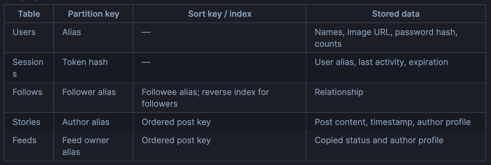

## 2026-11-03: package.json, package-lock.json, tweeter-server/package.json (new file), tweeter-server/tsconfig.json (new file), AI-ATTRIBUTION.md (new file)
- Tool: OpenAI Codex
- Task: Set up the tweeter-server workspace with a dependency on tweeter-shared and TypeScript build configuration. Record all file changes using the requested AI attribution format.
- Review: Everything is up to date. New files created and recorded using the AI attribution format.

## 2026-11-03: tweeter-shared/src/model/dto/UserDto.ts (new file), tweeter-shared/src/model/net/request/TweeterRequest.ts (new file), tweeter-shared/src/model/net/request/PagedUserItemRequest.ts (new file), tweeter-shared/src/model/net/response/TweeterResponse.ts (new file), tweeter-shared/src/model/net/response/PagedUserItemResponse.ts (new file), tweeter-shared/src/model/domain/User.ts, tweeter-shared/src/index.ts, AI-ATTRIBUTION.md
- Tool: OpenAI Codex
- Task: Begin the followers feature by defining shared request and response classes and explicit conversion between User instances and JSON data. Add the required attribution comment to every TypeScript file created or changed.
- Review: All files look accurate. `TweeterRequest` and `TweeterResponse` are the base classes that `PagedItemRequest/Response` use. This is so the interactions between client and server can be defined through the JSON that comes through.

## 2026-11-03: .gitignore, .idea/vcs.xml, AI-ATTRIBUTION.md
- Tool: OpenAI Codex
- Task: Migrate the existing tweeter-web Git repository to the project root, preserving its history and GitHub remote, and stage the entire project for review without committing. Update ignore rules for generated files in every module and point WebStorm's Git mapping at the project root; move Git metadata from tweeter-web/.git to .git without changing application source files.
- Review: `.gitignore` has appropriate ignore files in it. Review complete.

## 2026-11-03: tweeter-server/src/model/service/FollowService.ts (new file), tweeter-server/src/lambda/follow/GetFollowersLambda.ts (new file), AI-ATTRIBUTION.md
- Tool: OpenAI Codex
- Task: Implement the server followers service and Lambda handler, including request validation, user DTO conversion, and FakeData pagination. Add the required TypeScript attribution comments and leave the changes uncommitted for review.
- Review: `FollowService.ts` in the server calls FakeData. This is implementing the database layer, not calling serverFacade. `GetFollowersLambda.ts` formats the validateRequest function in terms that AWS Lambda will be able to understand. Review complete. 

## 2026-11-03: template.yaml (new file), Makefile (new file), tweeter-server/events/get-followers.json (new file), package.json, package-lock.json, .gitignore, README.md, AI-ATTRIBUTION.md
- Tool: OpenAI Codex
- Task: Set up AWS SAM for the followers feature, including a Lambda and non-proxy REST API template, error mappings, CORS, and a bundled deployment artifact containing tweeter-shared. Install and verify the SAM CLI, document build and deployment steps, and validate the local build without deploying AWS resources.
- Review: `template.yaml` explains what SAM will show for the followers feature. Lambda has already been created, and CORS and error mapping are defined as well on lines 31 and 75-104 respectively.

## 2026-11-03: template.yaml, README.md, AI-ATTRIBUTION.md
- Tool: OpenAI Codex
- Task: Deploy and test the approved followers backend, and record its deployed URL and verification results. Replace the broad API Gateway fallback error pattern with an explicit check for Lambda error payloads so successful responses use HTTP 200 and unexpected errors use HTTP 500.
- Review: Standard Lambda errors now contain errorMessage; successful page responses do not.

## 2026-11-03: tweeter-web/test/integration/FollowersEndpoint.test.ts (new file), tweeter-web/jest.integration.config.cjs (new file), tweeter-web/package.json, README.md, AI-ATTRIBUTION.md
- Tool: OpenAI Codex
- Task: Add repeatable Jest integration tests for the deployed followers endpoint, including expected data, pagination, validation errors, and CORS. Configure a separate Node-based integration test command and document how to run it alongside the existing component and presenter tests.
- Review: All tests passing.

## 2026-11-04: tweeter-web/src/net/ClientCommunicator.ts (new file), tweeter-web/src/net/ServerFacade.ts (new file), tweeter-web/src/model.service/FollowService.ts, tweeter-web/test/integration/ServerFacade.test.ts (new file), README.md, AI-ATTRIBUTION.md
- Tool: OpenAI Codex
- Task: Connect the client followers feature to the deployed backend through ClientCommunicator and ServerFacade, including response validation and User DTO conversion. Add live facade and client service integration tests, document browser verification, and leave changes uncommitted for review.
- Review: ClientCommunicator sends JSON requests and handles HTTP errors. `ServerFacade.ts` validates JSON responses and reconstructs User objects. New tests created for serverFacade. All tests passing

## 2026-11-04: tweeter-server/src/lambda/follow/GetFolloweesLambda.ts (new file), tweeter-server/src/lambda/validation/validatePagedUserItemRequest.ts (new file), tweeter-server/src/lambda/follow/GetFollowersLambda.ts, tweeter-server/src/model/service/FollowService.ts, tweeter-server/events/get-followees.json (new file), tweeter-web/src/net/ServerFacade.ts, tweeter-web/src/model.service/FollowService.ts, tweeter-web/test/integration/Followees.test.ts (new file), tweeter-web/test/server/FollowLambdas.test.ts (new file), template.yaml, Makefile, README.md, AI-ATTRIBUTION.md
- Tool: OpenAI Codex
- Task: Prepare the followees feature through the server Lambda, SAM API configuration, client facade, and client service, reusing paginated-user validation and response conversion. Add offline handler tests, followees integration tests, a sample request, and documentation before deployment review.
- Review: `validatePagedItemUserRequest` takes on the logic of validating a request for `getFollowersLambda.ts`. **CODEX created duplicate files for getFollowersLambda.ts and getFolloweesLambda.ts so it will be refactored before pushing**  

## 2026-11-04: tweeter-server/src/lambda/PagedUserLambda.ts (new file), tweeter-server/src/lambda/follow/GetFollowersLambda.ts, tweeter-server/src/lambda/follow/GetFolloweesLambda.ts, tweeter-web/test/server/FollowLambdas.test.ts, README.md, AI-ATTRIBUTION.md
- Tool: OpenAI Codex
- Task: Refactor followers and followees Lambda handling into a shared abstract PagedUserLambda using the Template Method pattern, with subclasses selecting their service operation. Preserve AWS handler exports, add regression tests for service delegation and error propagation, and document the shared flow.
- Review: `PagedUserLambda.ts` created to avoid code duplication - `GetFolloweesLambda.ts` and `GetFollowersLambda.ts` inherit and overwrite `loadPage()` method. All tests passing.

## 2026-11-05: tweeter-web/test/integration/Followees.test.ts, README.md, AI-ATTRIBUTION.md
- Tool: OpenAI Codex
- Task: Execute the approved followees deployment and shared-handler update, verify both deployed Lambdas, and run all live integration tests. Add explicit variable types in the followees pagination test for the project's Jest TypeScript compiler and update documentation with the successful deployment results.
- Review: Browser check confirms that followees/list shows 10, 10, 1, ends with `hasMore == false` 

## 2026-11-05: tweeter-shared/src/model/net/request/UserAliasRequest.ts (new file), tweeter-shared/src/model/net/response/CountResponse.ts (new file), tweeter-shared/src/model/net/request/PagedUserItemRequest.ts, tweeter-shared/src/index.ts, tweeter-server/src/lambda/validation/validateUserAliasRequest.ts (new file), tweeter-server/src/lambda/validation/validatePagedUserItemRequest.ts, tweeter-server/src/lambda/follow/GetFollowerCountLambda.ts (new file), tweeter-server/src/model/service/FollowService.ts, tweeter-server/events/get-follower-count.json (new file), tweeter-web/src/net/ServerFacade.ts, tweeter-web/src/model.service/FollowService.ts, tweeter-web/test/server/FollowerCountLambda.test.ts (new file), tweeter-web/test/net/ServerFacadeCount.test.ts (new file), tweeter-web/test/integration/FollowerCount.test.ts (new file), template.yaml, Makefile, README.md, AI-ATTRIBUTION.md
- Tool: OpenAI Codex
- Task: Prepare follower count through shared request/response classes, server validation and Lambda, SAM configuration, and the client facade/service. Reuse token-and-alias fields and validation for paginated requests, add offline and live integration tests, and document the pending deployment and browser check.
- Review: countResponse.ts and additional lambda functions created. Not all tests passing but is consistent with the endpoints that are not yet deployed. Will deploy after this commit.

## 2026-11-05: README.md, AI-ATTRIBUTION.md
- Tool: OpenAI Codex
- Task: Execute the approved follower-count change set, verify the deployed Lambda and HTTP responses, and run all 20 live integration tests. Update the documented deployment status and overall Milestone 3 checklist without changing application code.
- Review: Browser check shows followers/count reports the correct number of followers as well as status messages including when a user followers another user. All tests passed

## 2026-11-05: tweeter-server/src/lambda/CountLambda.ts (new file), tweeter-server/src/lambda/follow/GetFollowerCountLambda.ts, tweeter-server/src/lambda/follow/GetFolloweeCountLambda.ts (new file), tweeter-server/src/model/service/FollowService.ts, tweeter-server/events/get-followee-count.json (new file), tweeter-web/src/net/ServerFacade.ts, tweeter-web/src/model.service/FollowService.ts, tweeter-web/test/net/ServerFacadeCount.test.ts, tweeter-web/test/server/FollowerCountLambda.test.ts (removed), tweeter-web/test/server/FollowCountLambdas.test.ts (new file), tweeter-web/test/integration/FolloweeCount.test.ts (new file), template.yaml, Makefile, README.md, AI-ATTRIBUTION.md
- Tool: OpenAI Codex
- Task: Prepare followee count through its Lambda, SAM endpoint, client facade/service, sample request, and integration tests. Share count handling with the Template Method pattern, expand and rename count tests to cover both operations, and document the pending deployment.
- Review: followee count implemented through lambda, SAM, etc. `ServerFacade.ts` deduplicates code by creating a `getCount()` method. ServerFacade looks really good and does the facade job very well.

## 2026-11-05: README.md, AI-ATTRIBUTION.md
- Tool: OpenAI Codex
- Task: Execute the approved followee-count deployment and verify the direct Lambda response, public route availability, HTTP success/error responses, and all 24 live integration tests. Update the deployment documentation and overall milestone checklist without changing application code.
- Review: Browser check shows everything working as expected. followees/count shows correct number of followees, the right status message, and is persistent when I follow or unfollow someone.

## 2026-11-05: tweeter-shared/src/model/net/request/FollowingStatusRequest.ts (new file), tweeter-shared/src/model/net/response/FollowingStatusResponse.ts (new file), tweeter-shared/src/index.ts, tweeter-server/src/lambda/validation/validateTweeterRequest.ts (new file), tweeter-server/src/lambda/validation/validateUserAliasRequest.ts, tweeter-server/src/lambda/validation/validateFollowingStatusRequest.ts (new file), tweeter-server/src/lambda/follow/GetFollowingStatusLambda.ts (new file), tweeter-server/src/model/service/FollowService.ts, tweeter-server/events/get-following-status.json (new file), tweeter-web/src/net/ServerFacade.ts, tweeter-web/src/model.service/FollowService.ts, tweeter-web/test/server/FollowingStatusLambda.test.ts (new file), tweeter-web/test/net/FollowingStatus.test.ts (new file), tweeter-web/test/integration/FollowingStatus.test.ts (new file), template.yaml, Makefile, README.md, AI-ATTRIBUTION.md
- Tool: OpenAI Codex
- Task: Prepare following status through shared request/response classes, validation, the server Lambda, SAM endpoint, and client facade/service. Extract shared token validation, test both boolean results and alias direction, and document the pending deployment and browser verification.
- Review: `FollowingStatusRequest/Response.ts` takes care of the request and success response.

## 2026-11-09: README.md, AI-ATTRIBUTION.md
- Tool: OpenAI Codex
- Task: Execute the approved following-status AWS change set and verify the direct Lambda response, public POST and OPTIONS routes, and all 29 live integration tests. Update the deployment documentation and milestone progress, leaving browser verification for review.
- Review: Browser check correctly shows status information for follower status.

## 2026-11-09: tweeter-server/src/model/service/FollowService.ts, tweeter-server/src/lambda/follow/FollowLambda.ts (new file), tweeter-server/events/follow.json (new file), tweeter-web/src/net/ServerFacade.ts, tweeter-web/src/model.service/FollowService.ts, tweeter-web/test/server/FollowLambda.test.ts (new file), tweeter-web/test/net/Follow.test.ts (new file), tweeter-web/test/integration/Follow.test.ts (new file), Makefile, template.yaml, README.md, AI-ATTRIBUTION.md
- Tool: OpenAI Codex
- Task: Prepare Follow through the client facade, shared request/response contracts, server service, Lambda, and SAM route. Move the placeholder operation to the server, add offline and pending integration tests, and document deployment and browser verification.
- Review: FollowService allows a user to follow another user. The followLambda will be built and packaged and uploaded to AWS.

## 2026-11-09: README.md, AI-ATTRIBUTION.md
- Tool: OpenAI Codex
- Task: Execute the approved Follow AWS change set and verify the direct Lambda response, public POST and OPTIONS routes, and all 34 live integration tests after API propagation. Update deployment documentation and milestone progress, leaving the browser check for review.
- Review: Browser check shows follow status POST with correct request and response.

## 2026-11-09: tweeter-server/src/lambda/UserActionLambda.ts (new file), tweeter-server/src/lambda/follow/FollowLambda.ts, tweeter-server/src/lambda/follow/UnfollowLambda.ts (new file), tweeter-server/src/model/service/FollowService.ts, tweeter-server/events/unfollow.json (new file), tweeter-web/src/net/ServerFacade.ts, tweeter-web/src/model.service/FollowService.ts, tweeter-web/test/server/FollowLambda.test.ts, tweeter-web/test/net/Follow.test.ts, tweeter-web/test/integration/Unfollow.test.ts (new file), Makefile, template.yaml, README.md, AI-ATTRIBUTION.md
- Tool: OpenAI Codex
- Task: Prepare Unfollow through the client service/facade, server service, Lambda, and SAM endpoint, moving the placeholder operation to the server. Share Follow/Unfollow Lambda and facade handling, extend offline tests to cover both operations, add pending live tests, and update deployment documentation.
- Review: Unfollowing logic added to all follow server files. All tests passing.

## 2026-11-09: README.md, AI-ATTRIBUTION.md
- Tool: OpenAI Codex
- Task: Execute the approved Unfollow AWS change set and verify the direct Lambda response, stable public success/error and preflight responses, and all 39 live integration tests. Update deployment documentation and milestone progress, leaving browser verification for review.
- Review: Browser checks show lambda request and response is as-intended.

## 2026-11-09: tweeter-shared/src/model/net/response/GetUserResponse.ts (new file), tweeter-shared/src/index.ts, tweeter-server/src/model/service/UserService.ts (new file), tweeter-server/src/lambda/user/GetUserLambda.ts (new file), tweeter-server/events/get-user.json (new file), tweeter-web/src/model.service/UserService.ts, tweeter-web/src/net/ServerFacade.ts, tweeter-web/test/server/GetUserLambda.test.ts (new file), tweeter-web/test/net/GetUser.test.ts (new file), tweeter-web/test/integration/GetUser.test.ts (new file), Makefile, template.yaml, README.md, AI-ATTRIBUTION.md
- Tool: OpenAI Codex
- Task: Prepare Get User through a shared nullable user response, server service and Lambda, SAM route, and client service/facade. Preserve null for unknown aliases, validate and reconstruct user DTOs, add offline and pending live tests, and document deployment and browser verification.
- Review: GetUser function implemented through ServerFacade.ts. 

## 2026-11-09: README.md, AI-ATTRIBUTION.md
- Tool: OpenAI Codex
- Task: Execute the approved Get User AWS change set and verify the direct Lambda profile, stable public lookup/null/validation and preflight responses, and all 45 live integration tests. Update deployment documentation and milestone progress, leaving manual browser verification and review to the user.
- Review: Browser checks shows everything working as expected.

## 2026-11-09: tweeter-shared/src/model/net/request/TweeterRequest.ts, tweeter-shared/src/model/net/request/AuthenticatedRequest.ts (new file), tweeter-shared/src/model/net/request/UserAliasRequest.ts, tweeter-shared/src/model/net/request/FollowingStatusRequest.ts, tweeter-shared/src/model/net/request/LoginRequest.ts (new file), tweeter-shared/src/model/dto/AuthTokenDto.ts (new file), tweeter-shared/src/model/domain/AuthToken.ts, tweeter-shared/src/model/net/response/AuthenticationResponse.ts (new file), tweeter-shared/src/index.ts, tweeter-server/src/lambda/validation/validateTweeterRequest.ts, tweeter-server/src/lambda/validation/validateUserAliasRequest.ts, tweeter-server/src/lambda/validation/validateFollowingStatusRequest.ts, tweeter-server/src/lambda/validation/validateLoginRequest.ts (new file), tweeter-server/src/model/service/UserService.ts, tweeter-server/src/lambda/user/LoginLambda.ts (new file), tweeter-server/events/login.json (new file), tweeter-web/src/model.service/UserService.ts, tweeter-web/src/net/ServerFacade.ts, tweeter-web/test/server/LoginLambda.test.ts (new file), tweeter-web/test/net/Login.test.ts (new file), tweeter-web/test/integration/Login.test.ts (new file), Makefile, template.yaml, README.md, AI-ATTRIBUTION.md
- Tool: OpenAI Codex
- Task: Prepare Login through public/authenticated request classes, user/token DTOs, server service and Lambda, SAM endpoint, and client facade/service while preserving dummy login behavior and token storage compatibility. Add offline and pending live integration tests, preserve existing authenticated-request validation, and document deployment and manual verification.
- Review: ServerFacade implements login method. 

## 2026-11-09: README.md, AI-ATTRIBUTION.md
- Tool: OpenAI Codex
- Task: Execute the approved Login AWS change set and verify the direct Lambda user/token DTOs, stable public success/validation and preflight responses, and all 51 live integration tests, including token reuse for Get User. Update deployment documentation and milestone progress, leaving browser verification and review to the user.
- Review: Login successful on the browser end.

## 2026-11-10: tweeter-shared/src/model/net/request/RegisterRequest.ts (new file), tweeter-shared/src/index.ts, tweeter-server/src/lambda/AuthenticationLambda.ts (new file), tweeter-server/src/lambda/user/LoginLambda.ts, tweeter-server/src/lambda/user/RegisterLambda.ts (new file), tweeter-server/src/lambda/validation/validateRegisterRequest.ts (new file), tweeter-server/src/model/service/UserService.ts, tweeter-server/events/register.json (new file), tweeter-web/src/model.service/UserService.ts, tweeter-web/src/net/ServerFacade.ts, tweeter-web/test/server/RegisterLambda.test.ts (new file), tweeter-web/test/net/Register.test.ts (new file), tweeter-web/test/integration/Register.test.ts (new file), Makefile, template.yaml, README.md, AI-ATTRIBUTION.md
- Tool: OpenAI Codex
- Task: Prepare Register with Base64 image transport, shared authentication response handling, server validation/service/Lambda, and the SAM endpoint while preserving dummy registration behavior. Add offline and required facade integration tests, verify existing Login behavior, and document pending deployment; AWS change-set preparation awaits renewed CLI login.
- Review: `LoginLambda.ts` now includes an authenticate function to authenticate new users (register). Register created for `ServerFacade.ts`, 

## 2026-11-10: README.md, AI-ATTRIBUTION.md
- Tool: OpenAI Codex
- Task: Prepare, inspect, and execute the approved Register AWS change set after renewing CLI login. Verify the direct Lambda user/token DTOs, stable public success/validation and preflight responses, and all 58 live integration tests; update deployment documentation and milestone progress while leaving manual review to the user.
- Review: Browser check shows register returns 200 status and Allen Anderson's profile (which is the default profile right now).

## 2026-11-10: tweeter-server/src/model/service/UserService.ts, tweeter-server/src/lambda/user/LogoutLambda.ts (new file), tweeter-server/events/logout.json (new file), tweeter-web/src/model.service/UserService.ts, tweeter-web/src/net/ServerFacade.ts, tweeter-web/test/server/LogoutLambda.test.ts (new file), tweeter-web/test/net/Logout.test.ts (new file), tweeter-web/test/integration/Logout.test.ts (new file), Makefile, template.yaml, README.md, AI-ATTRIBUTION.md
- Tool: OpenAI Codex
- Task: Prepare Logout through the client service/facade, server service and Lambda, and SAM endpoint using the existing token-only request and base response. Move the simulated operation to the server, test validation/completion/failure behavior and the pending live endpoint, and update deployment documentation and progress.
- Review: Logout implemented through ServerFacade. UserService.ts calls ServerFacade.ts logout method which uses AWS to tell the UserService.ts in the server to logout the user. LogoutLambda also created for AWS deployment. 

## 2026-11-10: README.md, AI-ATTRIBUTION.md
- Tool: OpenAI Codex
- Task: Execute the approved Logout AWS change set and verify the direct Lambda response, stable public success/token-validation and preflight responses, and all 62 live integration tests. Update deployment documentation and milestone progress while leaving browser verification and review to the user.
- Review: When the user logs out, the browser responds with a 200 status that shows the user logged out successfully and also goes back to the login page. All tests are passing.  

## 2026-11-10: tweeter-shared/src/model/dto/StatusDto.ts (new file), tweeter-shared/src/model/domain/Status.ts, tweeter-shared/src/model/net/request/PagedStatusItemRequest.ts (new file), tweeter-shared/src/model/net/response/PagedStatusItemResponse.ts (new file), tweeter-shared/src/index.ts, tweeter-server/src/lambda/validation/validatePagedStatusItemRequest.ts (new file), tweeter-server/src/model/service/StatusService.ts (new file), tweeter-server/src/lambda/PagedStatusLambda.ts (new file), tweeter-server/src/lambda/status/GetStoryLambda.ts (new file), tweeter-server/events/get-story.json (new file), tweeter-web/src/model.service/StatusService.ts, tweeter-web/src/net/ServerFacade.ts, tweeter-web/test/server/StoryLambda.test.ts (new file), tweeter-web/test/net/Story.test.ts (new file), tweeter-web/test/integration/Story.test.ts (new file), Makefile, template.yaml, README.md, AI-ATTRIBUTION.md
- Tool: OpenAI Codex
- Task: Prepare Story through status DTOs and paged contracts, server service/Lambda, SAM route, and client facade/service while preserving the shared dummy status list. Reconstruct status authors and clickable segments, validate cursors and responses, add offline and required StatusService integration tests, and document pending deployment and milestone progress.
- Review: Story implemented through serverFacade and statusService. Tests written as well, lambda ready for AWS upload.

## 2026-11-10: README.md, AI-ATTRIBUTION.md
- Tool: OpenAI Codex
- Task: Execute the approved Story AWS change set and verify the direct Lambda first page, stable public success/validation and preflight responses, and all 69 live integration tests. Confirm complete 44-status pagination and the required client StatusService story test, and update deployment documentation and milestone progress while leaving browser verification to the user.
- Review: Browser status shows status response 200 and the correct amount of stories displayed.

## 2026-11-10: tweeter-server/src/model/service/StatusService.ts, tweeter-server/src/lambda/status/GetFeedLambda.ts (new file), tweeter-server/events/get-feed.json (new file), tweeter-web/src/model.service/StatusService.ts, tweeter-web/src/net/ServerFacade.ts, tweeter-web/test/server/StoryLambda.test.ts, tweeter-web/test/net/Story.test.ts, tweeter-web/test/integration/Feed.test.ts (new file), Makefile, template.yaml, README.md, AI-ATTRIBUTION.md
- Tool: OpenAI Codex
- Task: Prepare Feed through its server service/Lambda, SAM endpoint, and client service/facade using Story's existing status paging contracts. Share facade handling, extend offline tests to verify separate Feed/Story routing, add pending live Feed tests, and document dummy behavior and deployment progress.
- Review: Feed implemented through serverfacade and status service. lambda ready to upload to AWS.

## 2026-11-10: README.md, AI-ATTRIBUTION.md
- Tool: OpenAI Codex
- Task: Execute the approved Feed AWS change set and verify the direct Lambda first page, stable public success/validation and preflight responses, and all 74 live integration tests. Confirm complete Feed pagination and existing Story behavior, and update deployment documentation and milestone progress while leaving browser verification to the user.
- Review: Browser check shows response status 200 and the correct amount of posts (feed) displayed.

## 2026-11-10: tweeter-shared/src/model/net/request/PostStatusRequest.ts (new file), tweeter-shared/src/index.ts, tweeter-server/src/lambda/validation/validatePostStatusRequest.ts (new file), tweeter-server/src/lambda/status/PostStatusLambda.ts (new file), tweeter-server/src/model/service/StatusService.ts, tweeter-server/events/post-status.json (new file), tweeter-web/src/model.service/StatusService.ts, tweeter-web/src/net/ServerFacade.ts, tweeter-web/test/server/PostStatusLambda.test.ts (new file), tweeter-web/test/net/PostStatus.test.ts (new file), tweeter-web/test/integration/PostStatus.test.ts (new file), Makefile, template.yaml, README.md, AI-ATTRIBUTION.md
- Tool: OpenAI Codex
- Task: Prepare Post Status through a shared token/status request, server validation/service/Lambda, SAM endpoint, and client service/facade while preserving simulated posting. Share action response handling without changing existing errors, test DTO transport and completion/failure behavior, add pending live tests, and update documentation and the final-feature checklist.
- Review: Posting a status is deployed through server facade as well as both status services (web and server). Lambda ready for upload

## 2026-11-10: README.md, AI-ATTRIBUTION.md
- Tool: OpenAI Codex
- Task: Execute the approved final Post Status AWS change set and verify the direct Lambda response, stable public success/validation and preflight responses, and all 80 live integration tests across fourteen features. Update deployment documentation and milestone progress while leaving final browser review, submission documents, API export, and passoff preparation outstanding.
- Review: Browser check shows 200 OK status and success toast deleting. Everything looks good. 

## 2026-11-17: Milestone 3 submission documents
- Tool: OpenAI Codex
- Task: Trace the current status-posting implementation and create a UML sequence diagram PDF, SVG preview, editable PlantUML, and a reproducible renderer. Include the client/server StatusService objects, API Gateway JSON bridge, promise completion, and the listener's success message.
- Task: Prepare a reproducible project ZIP using current versionable files; extract a clearly labeled local Swagger reference from the SAM template; document the remaining stage export and documentation publication steps.
- Findings: All fourteen source POST methods have descriptions and declare 200/400/500 method responses. HTTP 500 uses a response-template override rather than a separate 500 integration response; this was flagged for rubric review. The AWS stage export could not be completed because the AWS login session expired. No AWS configuration was changed.
- Validation: Compared diagram calls with PostStatus, PostPresenter, both StatusService implementations, ServerFacade, ClientCommunicator, PostStatusLambda, validation helpers, and the SAM integration. Checked the rendered diagram, source endpoint coverage, and ZIP integrity. Application code was not changed by this documentation task.
- Review: Generated documents look good! Sequence diagram is correct and thorough, and readme correctly instructs how to see milestone 3 completion.

## 2026-11-17: Published API documentation and stage export
- Tool: OpenAI Codex
- Task: After the student renewed AWS authentication, export the deployed dev-stage API, inspect its documentation, complete documentation publication, and rebuild the submission ZIP.
- Changes: Retained the existing fourteen POST method descriptions, added descriptions to the fourteen CORS OPTIONS methods, and published documentation version `m3-docs-20261117` to `dev`. Exported the actual stage as `docs/milestone-3/swagger.aws.json` with integration extensions. Updated the submission checklist and packager validation. Consulted the official AWS documentation-import reference to prepare the documentation-only merge.
- Validation: Confirmed the stage's documentation version, descriptions and integration extensions for all fourteen POST and fourteen OPTIONS methods, and declared 200/400/500 POST method responses in the exported file. The runtime deployment remained `m0wxqb`. Rebuilt and verified the current project archive. No runtime integrations or application code were changed; endpoint tests were not rerun.
- Remaining issue: The actual deployed export confirms that HTTP 500 is produced through the default response-template override; a separate 500 integration response is absent. This remains flagged against the rubric.
- Review: Artifacts look good, now need to do the HTTP 500 response.

## 2026-11-17: Explicit HTTP 500 integration responses
- Tool: OpenAI Codex
- Task: Add and deploy a separate HTTP 500 integration response for every application POST endpoint, verify existing behavior, and refresh the submission artifacts.
- Changes: Added the selection pattern `(?s)^(?!\[Bad Request\]).+` to all fourteen POST integrations in `template.yaml`. It matches nonempty unexpected errors, including multiline messages, and excludes the validation prefix handled by HTTP 400. Each 500 response returns a generic JSON error and CORS. Retained the default-template override as a fallback. Updated submission validation, both READMEs, and the exported Swagger file.
- Deployment: Retrieved the original deployed CloudFormation template and reused its existing Lambda artifact locations. Verified that the proposed template changed only the fourteen integration responses. Reviewed and executed change set `m3-explicit500-20261117`, whose resource changes were limited to the REST API, stage, and API deployment. The stack reached UPDATE_COMPLETE, and dev now uses deployment `iv9v59` with documentation version `m3-docs-20261117` retained. No Lambda or IAM changes were made.
- Validation: `sam validate --lint --template-file template.yaml` passed. Local selection-rule checks covered empty, validation, unexpected, and multiline messages without overlapping 400/500 matches. All 80 live integration tests across 15 suites passed after deployment. The actual refreshed stage export contains all fourteen explicit 200/400/500 integration response sets and all twenty-eight method descriptions. Rebuilt and verified the project ZIP. A server failure was not deliberately injected into deployed Lambdas; the 500 checks verified configuration and selection rules.
- Sources: Consulted the official AWS Lambda error handling documentation: https://docs.aws.amazon.com/apigateway/latest/developerguide/handle-errors-in-lambda-integration.html
- Review: HTTP 500 response implemented. Milestone 3 complete.

## 2026-11-19: Milestone 4A DAO contracts and storage design
- Tool: OpenAI Codex
- Task: Prepare the complete database-agnostic DAO interfaces and SAM table/S3 definitions for review before implementing one feature at a time. Use the student's approved 30-minute inactivity window with TTL cleanup and explicit server expiration enforcement.
- Changes: Added `tweeter-server/src/model/dao/DAOModels.ts`, `DAOFactory.ts`, `UserDAO.ts`, `SessionDAO.ts`, `FollowDAO.ts`, `StoryDAO.ts`, `FeedDAO.ts`, and `ImageDAO.ts`, each with an AI attribution comment. Added five provisioned DynamoDB tables, a reverse relationship index, session TTL, a session-duration parameter, and a profile-image bucket with a prefix-scoped public-read policy in `template.yaml`. Extended `README.md` with the schema, operation contracts, planned feature sequence, and remaining work. Updated this log.
- Scope: Foundation only; concrete DAOs, authentication behavior, Lambda wiring, and integration-test migration are pending. No AWS deployment or Git commit performed.
- Validation: Server TypeScript build, SAM template lint validation, and `git diff --check` passed. SAM also reported a sandbox permission warning while attempting to write its global metadata outside the workspace; template validation completed successfully with exit code 0.
- Sources: Official AWS TTL documentation: https://docs.aws.amazon.com/amazondynamodb/latest/developerguide/TTL.html and https://docs.aws.amazon.com/amazondynamodb/latest/developerguide/ttl-expired-items.html
- Review: All DAO classes implemented. DAO factory is literally just the dependency injection we did in class. Template.yaml added 5 DynamoDB tables. 

## 2026-11-19: DynamoDB user DAO
- Tool: OpenAI Codex
- Task: Implement and verify only the concrete DynamoDB user DAO as the next reviewable milestone increment; leave changes uncommitted.
- Changes: Added `tweeter-server/src/model/dao/dynamodb/DynamoDBUserDAO.ts` with an injected document client/table name, conditional unique-alias creation, zero initial counts, strongly consistent lookup, explicit profile/credential mapping, malformed-record checks, and propagation of infrastructure errors. Added `@aws-sdk/client-dynamodb` and `@aws-sdk/lib-dynamodb` to `tweeter-server/package.json` and updated `package-lock.json`. Added `tweeter-web/test/server/DynamoDBUserDAO.test.ts` using the existing Jest setup and a mocked AWS client. Updated `README.md` and this log. New TypeScript files include AI attribution comments.
- Validation: `npm run build --workspace tweeter-server` passed. All 11 tests passed with `npm test --workspace tweeter-web -- --runInBand test/server/DynamoDBUserDAO.test.ts`. `git diff --check` passed. These are isolated client-mock tests; no live database writes or AWS deployment were performed. The first test run exposed Jest typing issues with overloaded SDK methods; switching mocks to async implementations resolved them.
- Scope: User persistence implementation only. Password hashing, session/image DAOs, factory implementation, service wiring, and live registration verification remain for later increments. No Git commit or push performed.
- Sources: Official AWS SDK v3 document-client guidance and conditional-write/consistent-read examples: https://docs.aws.amazon.com/sdk-for-javascript/v3/developer-guide/migrate-dynamodb-doc-client.html and https://docs.aws.amazon.com/sdk-for-javascript/v3/developer-guide/javascript_dynamodb_code_examples.html
- Review: DBUserDAO implemented. Client (DB) puts the new user into the DB if it doesn't exist, or returns the existing user if it exists.

## 2026-11-19: DynamoDB session DAO
- Tool: OpenAI Codex
- Task: Implement and verify the DynamoDB session DAO as a separate reviewable milestone increment, including TTL expiration enforcement, sliding activity refresh, and deletion for logout.
- Changes: Added `tweeter-server/src/model/dao/dynamodb/DynamoDBSessionDAO.ts` with an injected client/table name, conditional session creation, strongly consistent reads, explicit expiration checks, monotonic activity/expiration updates, compare-and-swap conditions, bounded contention retries, idempotent deletion, and record/time validation. Added `tweeter-web/test/server/DynamoDBSessionDAO.test.ts` with 30 isolated tests, including simulated competing refreshes and logout between read and update. Both new TypeScript files include attribution comments. Updated `README.md` and this log.
- Validation: `npm run build --workspace tweeter-server` passed. All 41 tests across both DAO suites passed with `npm test --workspace tweeter-web -- --runInBand test/server/DynamoDBSessionDAO.test.ts test/server/DynamoDBUserDAO.test.ts`. `git diff --check` passed. Tests mock the AWS client; concurrency scenarios simulate responses and verify conditional commands rather than exercising a live database. Initial compilation caught a TypeScript interface/index-signature mismatch; passing an explicit record copy resolved it.
- Scope: Session persistence only. Token generation/hashing, the 30-minute configuration, AuthorizationService, factory wiring, and Lambda authentication remain for subsequent increments. No AWS deployment, Git commit, or push performed.
- Sources: Official AWS conditional-update reference and TTL update guidance: https://docs.aws.amazon.com/amazondynamodb/latest/APIReference/API_UpdateItem.html and https://docs.aws.amazon.com/amazondynamodb/latest/developerguide/example_dynamodb_UpdateItemConditionalTTL_section.html
- Review: DBSessionDAO implemented. Can create a new session, TTL is 30 minutes unless refresh is called. After 30 minutes the session expires and is deleted.

## 2026-11-19: S3 image DAO
- Tool: OpenAI Codex
- Task: Implement and verify the S3 image DAO as the next separate milestone increment, including profile-image upload, image URL creation, cleanup deletion, and AWS error propagation.
- Changes: Added `tweeter-server/src/model/dao/s3/S3ImageDAO.ts` with an injected S3 client/bucket/region, raw-byte uploads under `image/`, image content-type metadata, encoded regional HTTPS URLs, conditional writes preventing image-ID overwrite, and deletion for registration cleanup. Uploads omit ACLs to match the existing BucketOwnerEnforced bucket and public-read policy. Added ID/nonempty-byte/content-type validation. Added `@aws-sdk/client-s3` in `tweeter-server/package.json` and updated `package-lock.json`. Added `tweeter-web/test/server/S3ImageDAO.test.ts` with 22 isolated tests; both new TypeScript files include attribution comments. Updated `README.md` and this log.
- Validation: `npm run build --workspace tweeter-server` passed. All 63 tests across the image, user, and session DAO suites passed with `npm test --workspace tweeter-web -- --runInBand test/server/S3ImageDAO.test.ts test/server/DynamoDBUserDAO.test.ts test/server/DynamoDBSessionDAO.test.ts`. `git diff --check` passed. Tests mock the AWS clients; no live S3 upload, public URL access check, or deletion was performed.
- Scope: Image persistence only. Base64 decoding, unique ID generation, image format selection, registration cleanup orchestration, factory wiring, permissions, and deployment remain for subsequent increments. The content-type check validates the supplied metadata rather than the file contents. No AWS deployment, Git commit, or push performed.
- Sources: Official AWS SDK v3 PutObject and DeleteObject references: https://docs.aws.amazon.com/AWSJavaScriptSDK/v3/latest/client/s3/command/PutObjectCommand/ and https://docs.aws.amazon.com/AWSJavaScriptSDK/v3/latest/client/s3/command/DeleteObjectCommand/
- Review: ImageDAO implemented. Can upload a new image, delete an image, and there is also an image key to get the imageID and make sure that the image is uploaded when regestering.

## 2026-11-20: AWS factory and configuration
- Tool: OpenAI Codex
- Task: Implement the AWS factory and validated deployment configuration as the next separate milestone increment, preparing the implemented user/session/image DAOs for authentication service injection.
- Changes: Added `tweeter-server/src/model/dao/AuthenticationDAOFactory.ts`, `model/dao/aws/AWSDAOFactory.ts`, and `config/AWSConfig.ts`. Updated the complete `DAOFactory.ts` to extend the authentication subset, preserving all six factory methods. The concrete AWS factory supplies the three implemented authentication DAOs without placeholder follow/story/feed methods, reuses instances and clients, and accepts injected SDK clients for tests. Configuration validates required resource names/region and positive whole-minute inactivity, defaulting to 30 minutes converted to seconds. Added shared SAM function environment variables referencing the user/session tables, profile-image bucket, and inactivity parameter. Added `tweeter-web/test/server/AWSDAOFactory.test.ts` with 20 tests. Updated `README.md` and this log. New/modified TypeScript files retain attribution comments.
- Validation: Server TypeScript build and SAM template lint validation passed. Factory/configuration tests and all existing DAO tests passed (83 tests total). `git diff --check` passed. The initial factory test run required an explicit Node type reference because the web test compiler limits included global types; that reference and explicit process imports resolved the compilation errors. SAM validation exited successfully but reported a sandbox warning when writing global metadata outside the workspace.
- Scope: Factory/configuration preparation only. Services and Lambdas still use the previous behavior. AuthorizationService, password hashing, IAM data permissions, and runtime wiring remain for later increments. No AWS requests, deployment, Git commit, or push performed.
- Sources: Official AWS Lambda client reuse/environment guidance and SAM globals reference: https://docs.aws.amazon.com/lambda/latest/dg/best-practices.html and https://docs.aws.amazon.com/serverless-application-model/latest/developerguide/sam-specification-template-anatomy-globals.html
- Review: `AWSDAOFactory.ts` and `AWSConfig.ts` created. Configs loads in the user from the databsase and factory creates the user, session, and image and returns them. 

## 2026-11-20: Authorization service
- Tool: OpenAI Codex
- Task: Implement AuthorizationService as a separate milestone increment with secure token creation, digest-only session storage, activity-based validation/refresh, authenticated revocation, and isolated tests.
- Changes: Added `tweeter-server/src/model/service/AuthorizationService.ts`, receiving the session factory subset and inactivity interval through dependency injection with no AWS dependencies. It generates 32 cryptographically random bytes encoded as a 64-character hexadecimal bearer token, stores a SHA-256 digest, preserves the client's millisecond AuthToken timestamp while using seconds in storage, and returns the authenticated session owner. Invalid/expired tokens produce a stable `[Unauthorized]` prefix for future API mappings. Logout support authorizes before deletion. Storage and secure-generator failures propagate. Added `tweeter-web/test/server/AuthorizationService.test.ts` with 28 tests, including a stateful lifecycle test. Both files include attribution comments. Updated `README.md` and this log.
- Validation: Server TypeScript build passed. AuthorizationService tests plus all existing DAO/factory tests passed (111 tests total). `git diff --check` passed. Tests use mocks and an in-memory SessionDAO double; no AWS requests were made.
- Scope: Service implementation only. Credential verification/password hashing, calls from existing services/Lambdas, AWS permissions, and API Gateway 401/CORS integration remain for subsequent increments. No deployment, Git commit, or push performed.
- Sources: Official Node.js crypto documentation for randomBytes and createHash: https://nodejs.org/docs/latest-v24.x/api/crypto.html
- Review: AuthorizationService implemented. Allows for creating a session, revoking a session, as well as authorizing a session and hashing tokens.

## 2026-11-20: Persistent registration and automatic sign-in
- Tool: OpenAI Codex
- Task: Implement registration with bcrypt password hashing, S3 profile-image upload, conditional user persistence, automatic session creation, Lambda dependency injection, and focused tests as the next milestone increment.
- Changes: Replaced FakeData registration in `tweeter-server/src/model/service/UserService.ts` with injected DAO/AuthorizationService calls, early duplicate lookup plus conditional creation, cost-12 salted bcrypt hashing, a 72-byte UTF-8 password limit, canonical Base64 decoding, extension/content-type mapping, unique image IDs, and duplicate-race cleanup. Other UserService methods remain pending migration. Added cached lazy composition in `tweeter-server/src/lambda/config/getUserService.ts` and connected `RegisterLambda.ts`, supporting injected test services. Added bcryptjs and the requested @types/bcryptjs in `tweeter-server/package.json`/`package-lock.json`. Updated RegisterFunction in `template.yaml` with scoped database/image permissions, 512 MB memory/30-second timeout, and accurate API descriptions. Added `tweeter-web/test/server/RegistrationService.test.ts` (28 tests) and updated `RegisterLambda.test.ts` for real-service delegation instead of dummy registration assumptions. Updated `README.md` and this log. New/modified TypeScript files include attribution comments.
- Validation: Server TypeScript build passed. All 334 tests across 16 server suites passed, including actual bcrypt hashing/password verification, automatic session persistence, duplicate races, failure propagation, and cleanup behavior. RegisterLambda bundled successfully with esbuild for Node 24 (temporary output under /tmp). SAM lint validation and `git diff --check` passed. The initial Lambda test run used the browser test environment and encountered an AWS SDK browser-export parse error; selecting the Node environment for this server test resolved it. SAM also reported its existing sandbox warning for global metadata writes outside the workspace.
- Limitations: Tests mock AWS; no live user/image/session writes or deployment occurred. Confirmed duplicate races clean up the new upload, but uncertain user-write failures retain the image to avoid deleting a potentially saved profile's photo. Session failures preserve the committed account/image. Login/logout persistence, protected endpoint authorization, feed behavior, and live registration integration-test migration remain pending. Existing live registration tests still target the deployed Milestone 3 backend. No Git commit or push performed.
- Sources: Official bcryptjs documentation for salted hashing, async APIs, and the 72-byte password limit: https://github.com/dcodeIO/bcrypt.js
- Review: Implemented getUserService.ts. UserService.ts no longer uses FakeData but actually puts the user in the database. 

## 2026-11-22: Persistent login and credential verification
- Tool: OpenAI Codex
- Task: Implement login using persisted users and bcrypt password verification, issue a new session only for matching credentials, and prepare the Lambda/API configuration as the next separate milestone increment.
- Changes: Replaced FakeData login in `tweeter-server/src/model/service/UserService.ts` with injected user lookup, async bcrypt comparison, the same 72-byte UTF-8 limit as registration, exact password preservation, public profile reconstruction, and AuthorizationService session creation. Unknown aliases and incorrect passwords share `[Unauthorized] Invalid alias or password.` Updated `tweeter-server/src/lambda/user/LoginLambda.ts` to use cached AWS composition and support injected test services. Updated LoginFunction in `template.yaml` with GetItem permission only on UsersTable, PutItem only on SessionsTable, 512 MB memory/30-second timeout, and accurate method documentation. Added login's explicit 401/CORS mapping and excluded both expected prefixes from its 500 selection rule. Added `tweeter-web/test/server/LoginService.test.ts` (16 tests) and updated `LoginLambda.test.ts` to replace dummy behavior assumptions. Updated `README.md` and this log. Changed/new TypeScript files retain AI attribution comments.
- Validation: Server TypeScript build passed. All 350 tests across 17 server suites passed, including real bcrypt comparison, fresh-session creation, overlong/wrong credentials, injection/delegation, and infrastructure failures. LoginLambda bundled successfully using esbuild for Node 24 to a temporary /tmp file. SAM template lint validation and `git diff --check` passed. Local checks verified eight login regex-selection cases (empty, validation, unauthorized, unexpected, multiline, and similar-prefix errors), nonoverlapping 400/401/500 matches, and 401 response/CORS declarations. SAM reported its existing sandbox warning writing global metadata outside the workspace, while validation exited successfully.
- Scope: Login persistence and local configuration only. Logout, other protected operations, their 401 mappings, remaining DAO implementations, and live authentication integration-test migration remain pending. Old live login/registration tests still target Milestone 3 expectations. No AWS requests, live HTTP verification, deployment, Git commit, or push performed.
- Sources: Official bcryptjs comparison/truncation documentation: https://github.com/dcodeIO/bcrypt.js ; official API Gateway Lambda error mappings: https://docs.aws.amazon.com/apigateway/latest/developerguide/handle-errors-in-lambda-integration.html
- Review: Login now implemented in UserService.ts. Same way as the register function in the previous attribution commit.

## 2026-11-22: Persistent logout and session revocation
- Tool: OpenAI Codex
- Task: Replace simulated logout with authenticated session revocation, connect its Lambda to the existing composition, and prepare permissions/error handling as the next milestone feature increment.
- Changes: Updated `tweeter-server/src/model/service/UserService.ts` to accept revocation through its authorization interface and delegate logout to AuthorizationService. Updated `tweeter-server/src/lambda/user/LogoutLambda.ts` with an injectable handler class using cached AWS composition after request validation. Updated LogoutFunction in `template.yaml` with GetItem/UpdateItem/DeleteItem permissions only on SessionsTable, accurate API documentation, explicit 401/CORS responses, and a nonoverlapping 500 selection pattern. Added `tweeter-web/test/server/LogoutService.test.ts` with 12 tests using real AuthorizationService and a stateful session DAO double, including post-logout rejection, same-user/other-user session isolation, expired/unknown tokens, repeated logout, and storage failures. Updated `LogoutLambda.test.ts` with composition/injection, authorization-error propagation, and validation-before-composition checks. Updated `README.md` and this log. Changed/new TypeScript files retain attribution comments.
- Validation: Server TypeScript build passed. All 364 tests across 18 server suites passed. LogoutLambda bundled successfully using esbuild for Node 24 to a temporary /tmp file. SAM lint validation and `git diff --check` passed. Local regex checks covered eight logout error-selection cases, nonoverlapping 400/401/500 matches, and 401 response/CORS declarations. SAM validation exited successfully with its existing sandbox metadata-write warning.
- Scope: Logout now revokes sessions in source. Remaining protected endpoints still need authentication wiring and persisted data. Old live authentication tests require real-session fixtures before deployment. Tests used mocked/in-memory DAOs; no AWS requests, live HTTP/CORS verification, deployment, Git commit, or push performed.
- Sources: Official API Gateway Lambda error mapping reference: https://docs.aws.amazon.com/apigateway/latest/developerguide/handle-errors-in-lambda-integration.html
- Review: Logout and session revoking implemented. `UserService.logout()` calls `revokeSession()`. that checks to see if the user is currently authorized under TTL and then deletes the session. 

## 2026-11-22: Authenticated persisted user lookup
- Tool: OpenAI Codex
- Task: Replace FakeData user lookup with session authorization and persisted profile retrieval as the next separate milestone feature increment.
- Changes: Updated `tweeter-server/src/model/service/UserService.ts` to authorize/refresh the caller's session before invoking UserDAO.getUser, reconstruct only the public profile, and preserve null for a missing alias. Removed its final FakeData import and expanded the injected authorization interface. Updated `tweeter-server/src/lambda/user/GetUserLambda.ts` to resolve cached AWS composition after validation and support injected test services. Updated GetUserFunction in `template.yaml` with GetItem permission on UsersTable, GetItem/UpdateItem on SessionsTable, accurate endpoint documentation, 401/CORS responses, and a nonoverlapping 500 pattern. Added `tweeter-web/test/server/GetUserService.test.ts` with 14 tests and updated `GetUserLambda.test.ts` for injected persisted-service behavior, null responses, authorization failures, and validation-before-composition. Updated `README.md` and this log. New/modified TypeScript files retain attribution comments.
- Validation: Server TypeScript build passed. All 379 tests across 19 server suites passed, including refresh beyond the previous expiry, expired records awaiting TTL cleanup, profile lookup after logout, and session/profile infrastructure errors. GetUserLambda bundled successfully using esbuild for Node 24 to a temporary /tmp file. SAM lint validation and `git diff --check` passed. Local regex checks verified eight user-lookup error-selection cases, nonoverlapping 400/401/500 matches, and 401/CORS declarations. SAM validation exited successfully with its existing sandbox global metadata-write warning.
- Scope: UserService's four operations now use the persistence/authentication layer in source. Follow/status services still require migration and protected-operation authorization. Old live user-lookup/authentication tests still require real-session fixtures. Tests use mocked/stateful in-memory DAOs; no AWS requests, live HTTP/CORS verification, deployment, Git commit, or push performed.
- Sources: Existing design and API Gateway Lambda error mapping reference used for the authentication increments: https://docs.aws.amazon.com/apigateway/latest/developerguide/handle-errors-in-lambda-integration.html
- Review: getUser implemented through UserService.ts. Simply looks through the database and checks to see if the user exists or not. All tests passing.

## 2026-11-22: DynamoDB follow DAO
- Tool: OpenAI Codex
- Task: Implement the complete follow DAO storage contract as a separate increment while avoiding duplicated mutation and pagination code. Keep the student's requested broader duplication review pending before milestone completion.
- Changes: Added `tweeter-server/src/model/dao/dynamodb/DynamoDBFollowDAO.ts` with atomic three-item relationship/count transactions, conditional idempotent follow/unfollow behavior, user existence/count checks, negative/overflow protection, self-follow rejection, consistent following-status/count lookups, and reverse-index follower queries. Follow/unfollow share one mutation helper and counter-update builder; followers/followees share one query helper with alias cursors, one-item lookahead, and internal DynamoDB pagination. Cancellation reasons distinguish confirmed duplicate operations from counter/infrastructure failures. Added `tweeter-web/test/server/DynamoDBFollowDAO.test.ts` with 41 isolated tests. Both files include attribution comments. Updated `README.md` and this log.
- Validation: Server TypeScript build passed. All 420 tests across 20 server suites passed. `git diff --check` passed. Tests cover transaction command structure, idempotent repeats, missing users, counter/error handling, both list directions with 13 aliases, lookahead retention, exact final pages, internal response boundaries, and input/configuration failures. Tests mock AWS responses; they do not verify live DynamoDB transaction atomicity or index propagation.
- Scope: Storage implementation only. AWS factory/configuration, FollowService/Lambda wiring, authentication, permissions, and live tests remain for the next relationship increments. No AWS requests, deployment, Git commit, or push performed. Broader duplication review remains pending before final passoff.
- Sources: Official AWS transaction and query references: https://docs.aws.amazon.com/amazondynamodb/latest/APIReference/API_TransactWriteItems.html and https://docs.aws.amazon.com/amazondynamodb/latest/APIReference/API_Query.html . Verified SDK v3 cancellation-reason availability against the AWS SDK maintainer clarification and local SDK implementation: https://github.com/aws/aws-sdk-js-v3/issues/3635 .
- Review: DynamoDBFolowerDAO.ts implemented. Relationships can be changed by following/unfollowing. Getting follower/followee counts is also possible with real data.

## 2026-11-23: Authenticated persistent follow and unfollow
- Tool: OpenAI Codex
- Task: Connect follow/unfollow mutations to the DAO and authentication layer as the next increment, deriving the acting user from the session and sharing mutation/composition code to limit duplication.
- Changes: Updated `tweeter-server/src/model/service/FollowService.ts` with injected follow factory/authorization and a shared mutation helper. Updated `config/AWSConfig.ts` and `model/dao/aws/AWSDAOFactory.ts` with required FOLLOWS_TABLE_NAME configuration and a cached FollowDAO instance. Added shared `lambda/config/getAWSDependencies.ts`, refactored `getUserService.ts` to reuse it, and added `getFollowService.ts`. Added `lambda/follow/FollowActionLambda.ts` so FollowLambda/UnfollowLambda share service resolution/delegation through the existing UserActionLambda validation template. Updated `template.yaml` with the table environment variable, scoped underlying transaction/session permissions, endpoint descriptions, and both routes' nonoverlapping 400/401/500 responses with CORS. Added `tweeter-web/test/server/FollowServiceActions.test.ts` (20 tests) and `AWSComposition.test.ts` (one shared-composition test); expanded `FollowLambda.test.ts` and `AWSDAOFactory.test.ts`. Updated `README.md` and this log. New/modified TypeScript files retain attribution comments.
- Validation: Server TypeScript build passed. All 447 tests across 22 server suites passed. Follow/Unfollow Lambdas bundled successfully with esbuild for Node 24 to temporary /tmp files. SAM lint validation and `git diff --check` passed. Each route passed eight local error-selection checks plus 401/CORS declaration checks. Tests cover acting-user derivation, authorization before mutation, waiting for transaction completion, self-follow rejection, idempotent delegation, error propagation, factory configuration, and shared dependencies. SAM exited successfully with its existing sandbox metadata-write warning.
- Scope: Follow/unfollow mutations now persist in source. Relationship count/list/status service methods still use FakeData and await migration. Feed backfill/removal is not introduced; future post delivery remains pending. Live authentication/mutation tests still need real-session fixtures. No AWS requests, deployment, Git commit, or push performed. Broader duplication review remains on the milestone checklist.
- Sources: Official AWS transaction IAM reference (permissions are the underlying PutItem/UpdateItem/DeleteItem/GetItem actions): https://docs.aws.amazon.com/amazondynamodb/latest/developerguide/transaction-apis-iam.html
- Review: FollowService implements following with real data. It changes the relationship in the database and creates the follow DAO.

## 2026-11-23: Persisted follower/followee counts and following status
- Tool: OpenAI Codex
- Task: Connect the two relationship count endpoints and following-status endpoint to authenticated DAO reads as the next milestone increment, sharing authorization/count handling to avoid duplication.
- Changes: Updated `tweeter-server/src/model/service/FollowService.ts` to load persisted counts through one selection helper and delegate following status to FollowDAO.isFollowing. Extracted a generic authorization/DAO-access helper shared by reads and mutations. Added `lambda/follow/FollowCountLambda.ts` to share count service resolution/delegation and updated GetFollowerCountLambda/GetFolloweeCountLambda to select their operations. Updated GetFollowingStatusLambda with injectable service composition. Updated `template.yaml` with scoped read/session-refresh IAM permissions, accurate API descriptions, 401/CORS responses, and nonoverlapping error patterns for the three routes. Added `tweeter-web/test/server/FollowServiceReads.test.ts` (23 tests) and updated FollowCountLambdas/FollowingStatusLambda tests to replace FakeData assumptions with delegation/injection and authorization checks. Updated `README.md` and this log. New/modified TypeScript files retain attribution comments.
- Validation: Server TypeScript build passed. All 473 tests across 23 server suites passed, including all existing mutation tests after shared-helper extraction. The three Lambdas bundled successfully with esbuild for Node 24 to temporary /tmp files. SAM lint validation and `git diff --check` passed. Each route passed eight local error-selection cases and 401/CORS declaration checks. Tests cover correct counter selection, zero values, status direction/booleans, authorization before reads, missing-user errors, and infrastructure failures. SAM validation exited successfully with its existing sandbox metadata-write warning.
- Scope: Counts and following status now use persisted data in source. Only list methods still use FakeData in FollowService; status posting/story/feed also remain to migrate. Existing live count/status tests require real sessions and persisted fixtures. No AWS requests, live HTTP/CORS verification, deployment, Git commit, or push performed. Broader duplication review remains pending before milestone completion.
- Sources: Existing DAO contracts/implementations and the API Gateway error mapping pattern established in prior increments: https://docs.aws.amazon.com/apigateway/latest/developerguide/handle-errors-in-lambda-integration.html
- Review: Forgot to review it prior to committing. FollowService gets follow count and status for real data and accurately returns the correct number by checking the followDAO from the database.

## 2026-11-23: Authenticated followers/followees pagination
- Tool: OpenAI Codex
- Task: Connect followers/followees lists to authenticated DAO queries and ordered public-profile loading, preserving the client cursor contract and sharing pagination logic.
- Changes: Updated `tweeter-server/src/model/service/FollowService.ts` to inject UserDAO access through its factory, share authenticated alias-page/profile loading, verify the viewed user exists, translate last-user aliases into DAO cursors, and remove its final FakeData import. Added `lambda/follow/FollowPageLambda.ts` and reduced GetFollowersLambda/GetFolloweesLambda to operation selectors over PagedUserLambda. Updated `template.yaml` with scoped Query/profile/session permissions, the specific follower-index ARN, accurate descriptions, and 401/CORS mappings excluding expected errors from 500. Added `tweeter-web/test/server/FollowServicePages.test.ts` (26 tests), updated FollowLambdas tests to replace dummy-data assumptions, and adjusted factory doubles in FollowServiceActions/Reads tests. Updated `README.md` and appended this log entry while preserving existing student edits. Changed/new TypeScript files retain attribution comments.
- Validation: Server TypeScript build passed. All 501 tests across 24 server suites passed. Both list Lambdas bundled with esbuild for Node 24 to temporary /tmp files. SAM lint validation and `git diff --check` passed. Each route passed eight local error-selection cases and 401/CORS declaration checks. Tests exercise 13 profiles through each Lambda/JSON cursor as pages of 10, 3, and 0 without duplicates, out-of-order profile completion, missing users/profiles, terminal pages, authorization, and storage failures. SAM exited successfully with its existing sandbox metadata-write warning.
- Scope: All user/relationship endpoint service implementations use persistence/authentication in source. Status posting/story/feed, live integration fixture migration, persisted seeding, deployment, and broader duplication review remain pending. In-memory fixtures do not satisfy the persisted passoff seed by themselves. No AWS requests, live HTTP/CORS verification, deployment, Git commit, or push performed.
- Sources: Official AWS IAM table/index resource guidance: https://docs.aws.amazon.com/amazondynamodb/latest/developerguide/iam-policy-specific-table-indexes.html
- Review: FollowService.ts can load more followers, meaning seeing who is a follower and who is a followee. All for real data. All 636 tests passing.

## 2026-11-23: DynamoDB story DAO and shared status pagination
- Tool: OpenAI Codex
- Task: Implement story storage with stable newest-first pagination and timestamp-tie cursors, while sharing database paging/row logic to avoid duplication with relationships and the upcoming feed DAO.
- Changes: Added `tweeter-server/src/model/dao/dynamodb/DynamoDBStoryDAO.ts`, `DynamoDBStatusStore.ts`, and `queryPage.ts`. Story writes use the author partition and a fixed-width timestamp/status-ID key, store only public status/author fields, and support replaying the same immutable post without another row. Shared status storage handles validation, row mapping, author isolation, and timestamp/ID cursors. Extracted the lookahead/internal-response pagination loop from DynamoDBFollowDAO into queryPage and reused it for story queries. Clarified the immutable-post replay contract in `model/dao/StoryDAO.ts`. Added `tweeter-web/test/server/DynamoDBStoryDAO.test.ts` with 31 tests. Updated `README.md` and this log. New/modified TypeScript files retain attribution comments.
- Validation: Server TypeScript build passed. All 532 tests across 25 server suites passed, including relationship pagination regressions. New tests cover 13 statuses in pages of 10/3/0 with equal timestamps crossing the page boundary, author isolation, identical replay, internal query boundaries, empty responses, invalid cursors/rows, public-field copying, and storage errors. `git diff --check` passed. Initial checks caught TypeScript guard narrowing of storage fields and synchronous invalid-cursor exceptions; preserving raw key fields before narrowing and making the page entry point async resolved them.
- Scope: Storage implementation only; the AWS factory/configuration, StatusService/Lambda wiring, shared status-ID DTO propagation, precomputed feed delivery, live fixtures/seeding, deployment, and final duplication review remain pending. Tests mock the AWS client and use an in-memory row map; no AWS requests, deployment, Git commit, or push performed.
- Sources: Official DynamoDB query ordering/pagination and primary-key replacement references: https://docs.aws.amazon.com/amazondynamodb/latest/APIReference/API_Query.html and https://docs.aws.amazon.com/amazondynamodb/latest/APIReference/API_PutItem.html
- Review: Story storage implemented. `DynamoDBStatusStore.ts` calls get page and uses additional functions to order the stories from not seen to seen using timestamp comparison.

## 2026-11-23: DynamoDB precomputed feed DAO
- Tool: OpenAI Codex
- Task: Implement feed storage with owner-isolated reads, idempotent recipient delivery, bounded batch writes/retries, and shared status encoding/pagination, as the next reviewable milestone increment.
- Changes: Added `tweeter-server/src/model/dao/dynamodb/DynamoDBFeedDAO.ts`, reusing DynamoDBStatusStore/queryPage for row mapping and newest-first owner pagination. Writes deduplicate recipients, retain original authors, split at 25 items or 16 MB of marshalled JSON request data, retry only unprocessed entries up to five attempts with exponential backoff/jitter, and fail explicitly on incomplete delivery. SDK-thrown errors propagate after the client's retry policy; pause is injectable for tests. Clarified immutable globally unique status-ID replay in `model/dao/FeedDAO.ts`. Added `@aws-sdk/util-dynamodb` as a direct dependency in server package.json/package-lock for wire-size measurement. Added `tweeter-web/test/server/DynamoDBFeedDAO.test.ts` with 24 tests. Updated the Jest TypeScript transform in `tweeter-web/package.json` to explicitly include Node/Jest plus existing Vite types after the full suite exposed a Node module type-resolution error in an existing pagination test. Updated `README.md` and this log, preserving existing student attribution edits. New/modified TypeScript files retain attribution comments.
- Validation: Server TypeScript build passed. All 691 offline tests across 39 suites passed, including all 556 server tests and client/component/presenter regressions. Tests verify owner/author separation, duplicate recipients, empty recipients, 25-item and 16-MB wire-size boundaries, retry subsets/exhaustion, partial failure propagation, and mixed-author 13-item pagination with timestamp ties and idempotent replay. `git diff --check` passed. Initial feed test compilation required narrowing the SDK's generic command type after an instanceof filter; explicit command casts after filtering resolved it.
- Scope: Feed persistence only. Shared DTO/domain status-ID propagation, AWS factory/configuration, StatusService/Lambda wiring, posting/fan-out orchestration, live fixtures/seeding, deployment, and final duplication review remain pending. Batch delivery is not atomic across recipients and can be partial on failure; retries require the same immutable status. Tests use mocked SDK responses and an in-memory row map. No AWS data requests, deployment, Git commit, or push performed.
- Sources: Official AWS batch limits/unprocessed-item retry guidance: https://docs.aws.amazon.com/amazondynamodb/latest/APIReference/API_BatchWriteItem.html and https://docs.aws.amazon.com/amazondynamodb/latest/developerguide/Programming.Errors.html . Official ts-jest inline compiler options: https://kulshekhar.github.io/ts-jest/docs/29.0/getting-started/options/tsconfig
- Review: Feed storage implemented through DynamoDBFeedDAO.ts and FeedDAO.ts. It is precomputed such that each user's feed entries are stored when a post is published for that user to see.

## 2026-11-23: Stable status identity in shared models and API
- Tool: OpenAI Codex
- Task: Carry stable status IDs through shared DTO/domain models, storage mapping, and client/server JSON cursors, preserving legacy/unsaved data compatibility as the next milestone increment.
- Changes: Added optional readonly statusId and PersistedStatusDto plus shared ID/persisted-DTO guards in `tweeter-shared/src/model/dto/StatusDto.ts`, and exported them from `src/index.ts`. Added immutable optional Status identity, DTO/local JSON preservation, identified-post equality, and legacy payload equality in `model/domain/Status.ts`. API timestamps now validate as nonnegative safe integers, matching storage keys. Updated `tweeter-server/src/model/dao/dynamodb/DynamoDBStatusStore.ts` to reuse the shared ID guard, include authoritative IDs in public status DTOs, normalize older nested payloads missing IDs, and reject conflicting nested IDs. Added `tweeter-web/test/model/StatusIdentity.test.ts` (21 tests). Updated net/Story, server/StoryLambda, PostStatusLambda, DynamoDBStoryDAO, and DynamoDBFeedDAO tests for ID preservation, equal-timestamp cursor identity, validation, and row normalization. Updated `README.md` and this log. New/modified TypeScript files retain attribution comments.
- Validation: Shared TypeScript compilation, server build, and web production build completed successfully. All 728 offline tests across 40 suites passed, including 564 server tests. Tests cover DTO/local JSON round-trips, legacy identity, distinct IDs on identical posts, client facade/service cursor serialization, Lambda cursor/result IDs, invalid ID/timestamp rejection, and storage ID consistency. `git diff --check` passed. Vite emitted CommonJS/default-export and chunk-size warnings while completing the build; browser verification was not performed.
- Scope: ID transport/model/storage normalization only. No client-generated IDs were introduced; server-side post ID generation, factory/configuration and StatusService/Lambda persistence wiring, precomputed fan-out orchestration, live fixtures/seeding, deployment, and final duplication review remain pending. No AWS data requests, deployment, Git commit, or push performed.
- Review: Status IDs implemented. StatusDto.ts now gets a status ID assigned by the server for persisted posts. It is used in Status.ts as part of the constructor. This makes sure it's a stable ID across models and API for posting and viewing.  

## 2026-11-23: Complete AWS DAO factory and status table configuration
- Tool: OpenAI Codex
- Task: Connect the story/feed DAO implementations to the AWS factory and deployment configuration as the next increment, completing the factory before StatusService migration.
- Changes: Updated `tweeter-server/src/config/AWSConfig.ts` with required STORIES_TABLE_NAME/FEEDS_TABLE_NAME settings and `model/dao/aws/AWSDAOFactory.ts` to implement the full DAOFactory interface without placeholder methods and cache the story/feed DAOs using the existing shared document client. Updated `template.yaml` global function environment to reference StoriesTable/FeedsTable. Extended `tweeter-web/test/server/AWSDAOFactory.test.ts` for both new required settings, DAO instance reuse, separate story/feed write targets, and query partitions. Updated `AWSComposition.test.ts` environment fixtures. Updated `README.md` and this log. Changed TypeScript files retain attribution comments.
- Validation: Server TypeScript build passed. All 732 offline tests across 40 suites passed, including all 568 server tests. SAM lint validation and `git diff --check` passed. Factory tests verify correct table/partition selection for story PutItem, feed BatchWriteItem, and both Query paths without AWS data requests. SAM validation exited successfully with its existing sandbox metadata-write warning.
- Scope: Factory/configuration only. StatusService posting/story/feed operations still use simulated/FakeData behavior. Their authentication, fan-out orchestration, Lambda wiring, IAM permissions, live fixtures/seeding, deployment, and final duplication review remain pending. No AWS data requests, deployment, Git commit, or push performed.
- Review: AWS DAO factory and status table now configured. Added in AWSConfig.ts and implemented in AWSDAOFactory.ts.

## 2026-11-23: Persistent posting and precomputed follower feed delivery
- Tool: OpenAI Codex
- Task: Connect status posting to authentication, authoritative server metadata, story persistence, and synchronous follower-feed delivery as the next milestone feature increment.
- Changes: Updated `tweeter-server/src/model/service/StatusService.ts` with injected DAO factory/authorization and real posting: authenticate, load the stored author profile, generate a server UUID/time, save the story, page through followers, and await feed delivery using one immutable record. Client author/time/ID are ignored; only post text is taken from the request. Added a non-advancing follower cursor guard. Added cached `lambda/config/getStatusService.ts` using shared AWS dependencies and updated `lambda/status/PostStatusLambda.ts` for injectable service composition and completion/error propagation. Updated `template.yaml` with scoped profile/session/story/follower-index/feed permissions, a 30-second posting timeout, accurate API descriptions, and nonoverlapping 400/401/500 responses with CORS. Added `tweeter-web/test/server/PostStatusService.test.ts` (16 tests), expanded PostStatusLambda tests, and extended AWSComposition coverage to status services. Updated `README.md` and this log. New/modified TypeScript files retain attribution comments.
- Validation: Server TypeScript build passed. All 750 offline tests across 41 suites passed, including 586 server tests. PostStatusLambda bundled with esbuild for Node 24 to a temporary /tmp file. SAM lint validation and `git diff --check` passed. Eight local error-selection cases and 401/CORS declarations passed. Tests cover trusted metadata over forged client fields, unique equal-timestamp posts, 113 followers across pages, no followers, awaiting delivery, authentication/storage failures, and partial-failure handling. Initial test compilation exposed older TypeScript inference trouble around the loop's page/cursor; an explicit Page<string, string> annotation resolved it. SAM exited successfully with its existing sandbox metadata-write warning.
- Scope/limitations: Posting now precomputes feed copies in source. Story/feed read endpoints still use FakeData and are the next migrations. Delivery is synchronous and may be partial on failure; the saved story and completed feed copies remain. Request-level idempotency/durable pending delivery are not implemented: a fresh HTTP submission receives a fresh ID. Follower queries use the eventual reverse index. Live fixtures/seeding, deployment, performance verification, and final duplication review remain pending. No AWS data requests, deployment, Git commit, or push performed.
- Sources: Official AWS table/index IAM resource guidance: https://docs.aws.amazon.com/amazondynamodb/latest/developerguide/iam-policy-specific-table-indexes.html
- Review: StatusService.ts implements postStatus with real data, allows for persistent posts and follower feeds precomputed.

## 2026-11-23: Authenticated persistent story retrieval
- Tool: OpenAI Codex
- Task: Replace dummy story reads with authenticated, author-scoped persistence and stable pagination as the next milestone feature increment.
- Changes: Updated `tweeter-server/src/model/service/StatusService.ts` to authorize/refresh the session, verify the requested author exists, validate persisted timestamp/status-ID cursors and author scope, query StoryDAO, reconstruct public Status/User objects, and derive hasMore from the DAO continuation. Updated `lambda/status/GetStoryLambda.ts` for injectable service composition using the cached getStatusService. Updated `template.yaml` with scoped user/session/story-read IAM and nonoverlapping story 400/401/500 mappings with CORS. Added `tweeter-web/test/server/StoryService.test.ts` (15 tests), including a real service/Lambda sequence across 13 posts sharing one timestamp. Updated StoryLambda tests to retain dummy assertions only for the unmigrated feed, cover injection/authorization errors, and ensure invalid requests do not resolve AWS composition. Extended AWSComposition tests to verify story reads use the shared dependencies. Updated README and this log. Changed TypeScript files retain attribution comments.
- Validation: Server TypeScript build passed. All 764 offline tests across 42 suites passed (600 server tests). GetStoryLambda bundled for Node 24 with esbuild to a temporary /tmp file. SAM lint validation passed; its existing sandbox metadata-write warning remains. Eight local error-selection cases and story error CORS declarations passed. Tests cover authorization ordering/failures, other-author visibility, empty/missing authors, JSON cursor round-trips through Lambda/service, pages of 10/3/0, timestamp ties, continuation flags, invalid/legacy/cross-author cursors, snapshot reconstruction, dependency injection, and storage errors. Initial test setup attempted an invalid ID rejected by the Status constructor and omitted the parameterized feature binding; corrected the tests before the passing full run. `git diff --check` passed.
- Scope/limitations: Story reads now use persistence in source. Feed reads are the remaining FakeData status operation and are the next increment. The existing live Story integration test still uses Milestone 3 fixtures; authenticated controlled live fixtures/seeding, deployment, browser scrolling/performance verification, and final duplication review remain pending. Offline pagination uses mocked DAOs/SDK responses and does not satisfy the live populated-tab requirement by itself. No AWS data requests, deployment, Git commit, or push performed.
- Review: Implemented retrieving story items persistently through the database.  

## 2026-11-23: Authenticated precomputed feed retrieval and shared status pagination
- Tool: OpenAI Codex
- Task: Replace the remaining dummy status operation with authenticated reads of persisted precomputed feed entries, while avoiding duplicated story/feed logic.
- Changes: Updated `tweeter-server/src/model/service/StatusService.ts` to route story/feed reads through a shared private loadStatuses operation for authentication, owner lookup, persisted cursor validation, DTO reconstruction, and hasMore. Feed reads call only FeedDAO.getFeed for the selected owner and allow mixed-author cursors; the story author constraint remains intact. Removed the final server FakeData dependency. Added generic `lambda/status/StatusPageLambda.ts` for shared service injection/cached composition and reduced GetStoryLambda/GetFeedLambda to operation selectors. Updated `template.yaml` with scoped profile/session/feed-query permissions and feed 400/401/500 CORS mappings with nonoverlapping patterns. Added `tweeter-web/test/server/FeedService.test.ts` (15 tests), generalized StoryLambda tests across both real operation paths, and extended AWSComposition coverage to feed reads. Updated README and this log. Changed TypeScript files retain attribution comments.
- Validation: Server TypeScript build passed. All 778 offline tests across 43 suites passed (614 server tests). Both status-read Lambdas bundled for Node 24 with esbuild to temporary /tmp files. SAM lint validation and `git diff --check` passed; SAM emitted its existing sandbox metadata-write warning. Sixteen local story/feed error-selection cases and 400/401/500 CORS declarations passed. Source scan confirmed no FakeData use remains under tweeter-server/src. Tests cover mixed-author public snapshots, authorization before storage, owner-scoped cursor reuse, JSON pages of 10/3/0 across 13 equal-timestamp records, no relationship/story reads or feed writes on retrieval, empty/missing owners, invalid/legacy cursors, DAO continuation flags, injection/composition, and storage failures. Existing story and posting tests pass against the shared implementation.
- Scope/limitations: All server features now use DAOs and authentication in source. As with the existing selected-user tab behavior, any authenticated user can view a selected user's feed. Feed reads query only precomputed owner entries and do not dynamically assemble posts. Live Milestone 3 integration fixtures need migration; controlled persisted fixtures/seeding with more than ten displayed items, deployment, browser scrolling/error verification, performance verification, and final duplication review remain pending. Offline tests use mocks and do not fulfill live verification by themselves. No AWS data requests, deployment, Git commit, or push performed.
- Review: Precomputed feed retrieval implemented. All tests passing.

## 2026-11-23: Server duplication review and shared validation/composition
- Tool: OpenAI Codex
- Task: Review the completed server for avoidable duplication before live fixture/deployment work, refactoring shared responsibilities without changing endpoint behavior.
- Changes: Added generic `tweeter-server/src/lambda/validation/validatePagedItemRequest.ts` and delegated both user/status page validators to it, retaining endpoint-specific cursor guards and exact error messages. Added/exported `isUserDto` in `tweeter-shared/src/model/dto/UserDto.ts` and `src/index.ts`; both user cursor validation and StatusDto's nested author validation now reuse it. Added `lambda/config/createServiceProvider.ts` and reduced getUserService/getFollowService/getStatusService to constructor callbacks, centralizing deferred dependency resolution and successful-service caching. Updated README with the review findings, existing reuse map, and reasons for retaining separate user/session DAO implementations and small type-specific pagination adapters. Changed TypeScript files retain attribution comments.
- Validation: Shared package build/compilation, server TypeScript build, and web production build passed. All 778 existing offline tests across 43 suites passed, including 614 server tests covering page validation/error messages, malformed nested users, request validation before composition, injection, warm service reuse/shared dependencies, authentication, and pagination. `git diff --check` passed. Existing Vite CommonJS/default-export and bundle-size warnings and local Node/npm/AWS SDK version warnings were emitted; no browser verification was performed. Existing behavioral tests were reused for this refactor; no implementation-mirroring tests were added.
- Review findings: Substantial reuse already exists in FollowService helpers, DynamoDBFollowDAO relationship/count/query helpers, StatusService.loadStatuses, StatusPageLambda, AuthenticationLambda, queryPage, DynamoDBStatusStore, and feed batch retry logic. User account storage and session refresh/expiration have different persistence semantics, so no common DAO superclass was introduced. Endpoint-specific response/domain adapters and explicit API Gateway response declarations remain. Separate feature fixtures retain behavior-specific assertions. This is a manual design/code review, not a numeric duplicate-code scanner report.
- Scope/limitations: Behavior-preserving local refactor only. Live integration fixture migration/seeding with more than ten displayed items, deployment, browser/error/scrolling verification, and performance verification remain pending. No AWS data requests, infrastructure changes, deployment, Git commit, or push performed.
- Review: Shared validation and service initialization consolidated. Duplicate code was reviewed and removed to be consolidated.

## 2026-11-23: Persisted status integration fixtures and explicit seed tooling
- Tool: OpenAI Codex
- Task: Prepare deterministic persisted story/feed fixtures and migrate those live integration tests away from Milestone 3 dummy tokens/data, including more than ten entries for scrolling verification.
- Changes: Added `tweeter-server/src/tools/milestone4Fixtures.ts` for versioned public fixtures: four isolated accounts, two authors with thirteen posts each, mixed-author twenty-six-entry reader feed, stable IDs and timestamp ties, and empty-list accounts. Added database-agnostic `seedMilestone4.ts` using DAOFactory: preflight alias checks, unique S3 profile-image upload, separately salted password hashes supplied by callback, conditional user creation, two follow relationships, and explicit story/feed snapshots. Added `seedMilestone4CLI.ts` and the server seed:milestone4 npm script: default credential-free dry run, strict arguments/namespace, explicit --write/--output, environment password, exclusive manifest reservation, and no manifest on incomplete runs. Added .gitignore entry for generated milestone4-fixtures manifests. Replaced Story/Feed live test bodies with a shared persistedStatusSuite using explicit API/manifest/password configuration, normal login and session cleanup, exact expected snapshots, client domain reconstruction, JSON pagination, isolation/empty accounts, 400/401 CORS responses, and preflight. Added fourteen offline seed tests. Updated README with dry-run/write/test/browser instructions and remaining live-suite migration scope. New/modified TypeScript files retain attribution comments.
- Validation: Server TypeScript build and strict standalone compilation of both migrated live integration entry points/support passed. All 792 offline tests across 44 suites passed, including 628 server tests. Seed tests verify fixture ordering/identity/counts, mixed authors and empty accounts, separate password hashes without secrets in manifests, existing/concurrent alias rejection, and image/user/follow/story/feed error propagation. CLI dry run succeeded with AWS configuration and test password removed from its subprocess environment; four argument/password failure guards also passed and created no output file. Validated the embedded PNG signature/chunk CRCs and decompressed pixel data; an initial copied placeholder failed its IDAT checksum and was replaced with a generated valid one-pixel RGB PNG. `git diff --check` passed. Existing local AWS SDK Node-version warnings remain.
- Scope/limitations: Tooling and test preparation only; no AWS data requests, actual seed writes, live API tests, deployment, browser scrolling/image delivery checks, Git commit, or push performed. Seed writes bypass HTTP posting/fan-out and do not verify API registration. They are nontransactional: partial failures may leave resources and require a fresh namespace plus explicit review, with no destructive reset/automatic resource deletion. Keep fixtures read-only for exact-snapshot tests. Remaining live authentication/relationship/mutation suites still use Milestone 3 assumptions and need migration before a full live run. The more-than-ten-items tab requirement remains unverified until the explicit seed and browser checks succeed against deployed Milestone 4A resources.
- Review: Memory data built. milestone4Fixtures.ts builds the test data in memory with 4 user profiles, 13 posts per author, a 26-post feed for the reader, and expected IDs, timestamps, and ordering for the tests. seedMilestone4.ts uses the DAO to save the data, upload the profile image, and create the two follow relationships. Nothing written to AWS yet.

## 2026-11-24: Seed readiness check and dry run
- Tool: OpenAI Codex
- Task: Check readiness to create the fixture data after discussing the fixture builder and seed tool.
- Actions/validation: Confirmed the working tree was clean, inspected the seed CLI/configuration, rebuilt the server successfully, and ran the seed dry run for namespace m4a20261124. The plan contains four users, two relationships, twenty-six story entries, twenty-six feed entries, and one image. Checked only presence/absence of relevant environment variables; no credential values were printed. No AWS resource configuration, fixture password, or fixture manifest is configured in this process; README records Milestone 4A deployment as pending.
- Scope: No application code changed, AWS requests, seed writes, deployment, Git commit, or push performed. Clarification requested on whether to populate AWS fixtures or continue migrating remaining integration tests.
- Review: Pending user review.

## 2026-11-24: Persisted account integration suites and shared live test setup
- Tool: OpenAI Codex
- Task: Continue locally with integration-test migration before deployment/seeding, starting with login, registration, logout, and public user lookup as the next reviewable increment.
- Changes: Replaced Milestone 3 assumptions in `tweeter-web/test/integration/Login.test.ts`, Register.test.ts, Logout.test.ts, and GetUser.test.ts with fixture credentials, normal login sessions, persisted public profiles, unique registration aliases, and actual error semantics. Account checks cover independent sessions, wrong/missing credentials, logout revocation/reuse rejection, automatic registration sign-in, empty feed/story and zero counts, public uploaded PNG bytes, duplicate preservation, and subsequent login. Added `support/liveTestContext.ts` for explicit configuration/manifest validation, token tracking/cleanup, and common error/CORS/preflight assertions. Migrated the Story/Feed shared suite to the same setup/assertion helpers. Exported the already-validated PNG constant from milestone4Fixtures.ts for registration/seed reuse and updated the seed CLI import. Added five offline LiveTestContext tests for configuration/manifest rejection before network access and selective/idempotent session cleanup with mocked fetch. Updated README with six-suite run instructions and live resource side effects. Existing attribution entries/user review text preserved; changed TypeScript files retain attribution comments.
- Validation: Server TypeScript build passed. Strict standalone compilation of all six migrated live integration entry points/support passed. All 797 offline tests across 45 suites passed (633 server tests). Source scan found no dummy tokens, Milestone 3 references, or fallback deployed URL in the six migrated entry points/shared support. `git diff --check` passed. Existing local AWS SDK Node-version warnings remain. Live integration assertions were compiled but not executed against AWS.
- Scope/limitations: Test preparation and shared fixture-byte extraction only. No AWS requests, new live accounts/images/sessions, fixture writes, deployment, Git commit, or push performed. When explicitly run live, registration creates two unique accounts/images per run; session cleanup revokes acquired sessions but there is no account-deletion endpoint. Seed snapshots remain unchanged. Relationship, posting, and legacy ServerFacade live suites still need migration; live inactivity expiration/activity refresh, deployment/seeding, and browser verification remain pending.
- Review: Migrated login, registration, logout, and user-lookup integration tests to persistent fixtures and real sessions. Al 797 offline tests passed.

## 2026-11-24: Diagnose forty-five live integration failures
- Tool: OpenAI Codex
- Task: Investigate the reported forty-five failing integration tests.
- Findings/validation: Reproduced all six migrated live suites with Jest JSON output in /tmp. Exactly 45 tests failed, and every failure cites missing TWEETER_API_BASE_URL in shared beforeAll configuration; no other failure messages were present. TWEETER_FIXTURE_PATH and TWEETER_TEST_PASSWORD are also unset in this process. The tests stop before HTTP calls. These are unavailable-live-setup failures, not successful live verification or evidence of forty-five distinct application defects. Earlier 797-pass results refer only to offline tests; the live suites had previously only been compiled.
- Scope: Diagnosis only; no application/test code changes, AWS requests, deployment, seed writes, Git commit, or push performed. Deployment, seeding, explicit live configuration, and actual API verification remain required.
- Review: All failing integration tests are because `TWEETER_API_BASE_URL` is missing, as well as fixture path and password.

## 2026-11-24: Persisted relationship and posting integration migration
- Tool: OpenAI Codex
- Task: Finish migrating the remaining live integration suites before deployment and seeding, preserving seeded snapshots and avoiding duplicate test workflows.
- Changes: Replaced dummy assumptions in Follow, Unfollow, FollowingStatus, FollowerCount, FolloweeCount, FollowersEndpoint, Followees, and PostStatus integration tests. Added shared relationshipMutationSuite, relationshipCountSuite, and relationshipPageSuite runners. Tests assert exact directed state and zero/nonzero counters, repeated mutation idempotence, self/missing-target rejection, public profiles, facade/service/endpoint pagination and JSON cursors, terminal/empty pages, API Gateway unknown-route CORS, and 400/401/preflight behavior. Mutation suites register isolated actor/target accounts. Posting uses an isolated author/reader pair and verifies authoritative server identity/time/ID, immediate precomputed delivery on success, retained earlier feed entries, and stopped future delivery after unfollow. Added shared registerLiveUser and bounded follower-index convergence helpers to liveTestContext. Removed redundant ServerFacade.test.ts after consolidating its follower facade/service/cursor checks into the follower suite. Added three offline convergence-helper tests. Updated README with full live-run instructions, remaining verification prerequisites, and persistent test resource side effects. Existing attribution/review text preserved; changed TypeScript files retain attribution comments.
- Validation: All 800 offline tests across 45 suites passed (636 server tests). All fourteen live entry points and their support modules passed strict standalone compilation with both the available compiler and the web workspace's TypeScript 4.9.5 used by test tooling. Jest --listTests discovers fourteen live suites without executing HTTP requests. Source scan found no Milestone 3 dummy credentials, FakeData references, or the old fallback API URL under test/integration. `git diff --check` passed. Offline helper tests verify successful-read convergence, twelve-read exhaustion, and immediate error propagation using mocked delays. Initial helper test compilation needed an explicit result generic on untyped Jest mocks; namespace timer spying also failed on a nonconfigurable export, corrected with a module mock before the passing full run. Existing local AWS SDK Node-version warnings remain.
- Scope/limitations: Live test preparation only; no live API requests, deployments, seed writes, new AWS accounts/images/posts/sessions, Git commit, or push performed. When explicitly run against AWS, the full suite creates eight unique user accounts/images and four posts/two delivered feed entries; it removes test relationships and revokes sessions, while accounts/images/posts remain because deletion endpoints do not exist. Baseline seeded snapshots are preserved. Follower-index waits allow twelve successful reads with 250 ms pauses; HTTP/auth/storage failures propagate, and successful posting must deliver feeds without polling. Live suites still fail setup without explicit API/manifest/password configuration. Deployment/seeding, successful live API verification, inactivity expiration/activity refresh checks, and browser passoff remain pending. The 800-pass result is for offline tests only.
- Review: Relationships and posting integration tests migrated.
